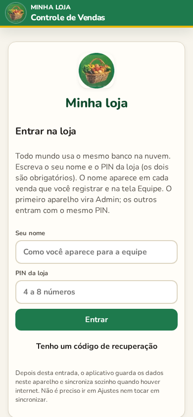
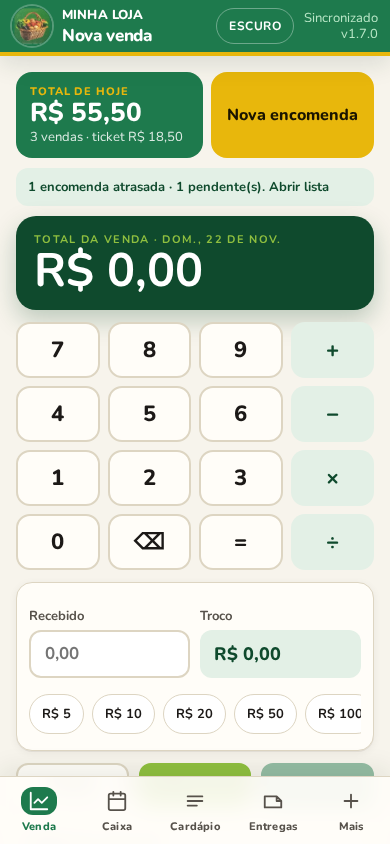
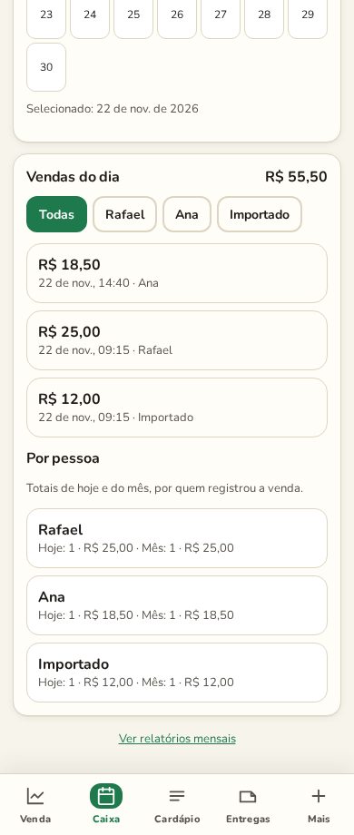
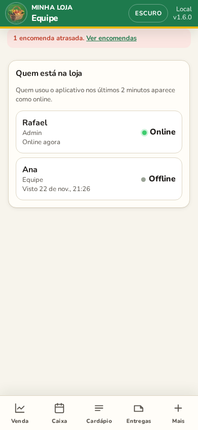
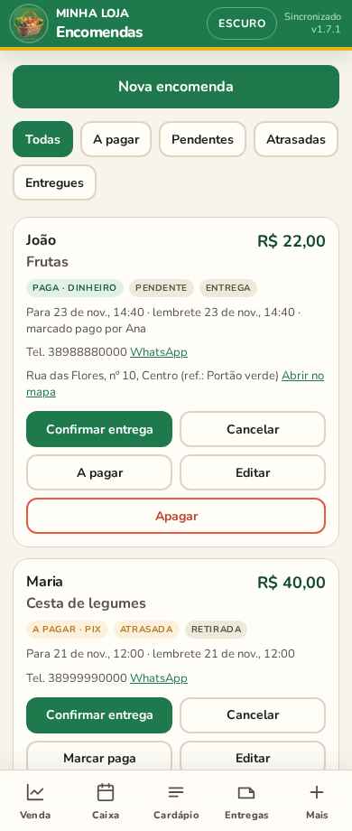

# Controle de Vendas

Aplicativo de caixa, cardápio, entregas e livro de vendas. Funciona no celular e no computador, inclusive sem internet.

## O que ele faz

- Calculadora em centavos, com apagar o último dígito, contas, soma dos últimos números (expira em 5 minutos), troco e registro da venda.
- Livro caixa com totais do dia, da semana, do mês e geral, calendário de faturamento e ticket médio.
- Cardápio com promoções agendadas e compartilhamento pelo WhatsApp.
- Entregas com situação (pendente, a caminho, entregue) e WhatsApp.
- Encomendas, reabastecimento (custo e preço sugerido) e cobranças **manuais de teste**.
- Cada venda mostra quem registrou (ou “importado”, no histórico antigo). Dá para filtrar e ver o total por pessoa no dia e no mês.
- Tela Equipe, com quem está online (último acesso nos últimos 2 minutos) e quando cada pessoa foi vista.
- Relatórios mensais em **Mais → Relatórios** (fora da barra principal).
- Dados no aparelho (IndexedDB). Quando houver internet e você estiver autenticado, a sincronização é nos dois sentidos com a nuvem (Supabase).
- Backup por arquivo JSON e, se você configurar o Google, o botão “Salvar no Google Drive”.
- O nome da loja se configura em **Mais → Ajustes**.
- Leitor de código de barras na venda e no cardápio (pela câmera), para produtos vendidos por unidade — não por quilo. Um produto pode ter vários códigos, sem repetir.

Este aplicativo **não** envia cobranças reais para Stone ou PicPay e **não** guarda tokens de maquininha.

## Abrir no celular

Depois de publicado no GitHub Pages, abra o endereço do site no navegador do telefone e use “Adicionar à tela inicial”.

Enquanto a publicação não estiver no ar, no computador:

```bash
npm install
npm run dev
```

O endereço local usa o caminho `/controle-de-vendas/`.

## Primeiro uso e os seus dados

O histórico de vendas **não** entra neste repositório (são dados da loja). No primeiro uso, importe o arquivo JSON de backup que você recebeu em separado (repositório privado de dados, ou o arquivo enviado para o seu computador). Você também pode começar do zero.

## Ligar a nuvem

A nuvem já vem configurada (projeto Supabase `controle-de-vendas`, região São Paulo). O aplicativo abre direto na venda e entra sozinho na loja como membro, sem tela de nome. Se não houver internet, funciona offline e tenta conectar de novo sozinho. O nome é opcional (Ajustes). O Admin reivindica o papel em Ajustes com o código de recuperação. Todos usam o mesmo banco, e a sincronização é automática. Depois o aplicativo funciona sem internet e envia as mudanças quando a conexão volta. Só o Admin gerencia a equipe, o código de recuperação, o registro de atividades, o faturamento por pessoa e as configurações da loja. Não há convite por e-mail nem PIN compartilhado.

O login anônimo precisa estar ligado no painel do Supabase (Authentication → Providers → Anonymous). O passo a passo está em [GUIA-FIREBASE.md](GUIA-FIREBASE.md) e no aplicativo, em **Mais → Ajustes → Guia**.

## Aplicativo Android

O APK de cada versão fica em [Releases](https://github.com/rafaelytofc7-spec/controle-de-vendas/releases). No Android, entre com o nome. O histórico oficial já está na nuvem e desce depois da entrada; você também pode importar um backup pelo seletor de arquivos do aparelho. O histórico da loja **não** vem embutido no APK.

## Testes

```bash
npm test          # matemática, promoções, importação, nomes
npm run build
npm run test:e2e  # fluxos locais (calculadora, leitor, relatórios)
npm run test:e2e:nuvem  # dois aparelhos contra o projeto real, em uma loja de teste
```

## Telas

As capturas usam um nome de loja genérico.











## Licença

Uso privado do dono do repositório.

## Publicação

O site é publicado na branch `gh-pages`. O arquivo `docs/github-pages-workflow.yml` pode ser usado depois, se o token do GitHub tiver permissão de workflow.
